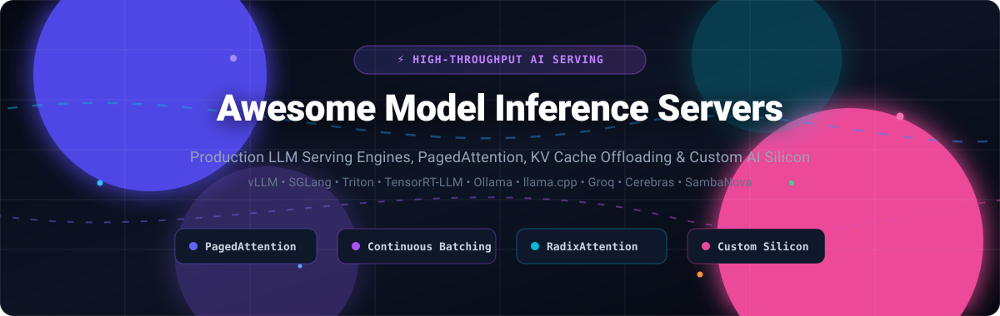

# ⚡ Awesome Model Inference Servers

  

  
  
  
  
  
  
  
  

---

## 📖 Executive Summary & SEO Guide

**Awesome Model Inference Servers** is the definitive, community-curated directory tracking high-performance **Large Language Model (LLM) serving engines**, **open-source inference runtimes**, and **managed SaaS AI silicon platforms**.

Modern production AI inference is constrained by GPU memory bandwidth and Key-Value (KV) cache utilization rather than raw compute FLOPS. The systems indexed here implement cutting-edge algorithmic optimizations:
* **PagedAttention**: Virtual memory paging for dynamic KV cache allocation to eradicate memory fragmentation (vLLM).
* **RadixAttention & Prefix Caching**: Tree-structured KV cache sharing across multi-turn agent conversations and RAG system prompts (SGLang).
* **Continuous & In-Flight Batching**: Dynamically injecting newly arrived requests at token boundaries rather than waiting for batch completion (Triton, TensorRT-LLM, vLLM).
* **Speculative Decoding & Medusa**: Small draft models predicting future tokens in parallel with verification by the target foundational LLM.
* **Custom AI Accelerators & LPUs**: Domain-specific silicon delivering ultra-low first-token latency and thousands of tokens per second (Groq LPUs, Cerebras Wafer-Scale CS-3, SambaNova RDUs).

> [!NOTE]
> **Ecosystem Alert (March 2026)**: Text Generation Inference (**TGI**) entered official maintenance mode as of December 11, 2025. Hugging Face officially advises teams deploying new production workloads to standardize on **vLLM** or **SGLang** for OpenAI-compatible LLM serving [citation:11][citation:13].

---

## 📑 Table of Contents

- [📊 Sector Overview & Market Dynamics](#-sector-overview--market-dynamics)
- [☁️ SaaS & Hosted AI Inference Platforms](#️-saas--hosted-ai-inference-platforms)
- [🚀 Top Open-Source Model Inference Engines](#-top-open-source-model-inference-engines)
- [🧩 Emerging & Specialized Open-Source Runtimes](#-emerging--specialized-open-source-runtimes)
- [🧠 Architectural Comparison & Decision Matrix](#-architectural-comparison--decision-matrix)
- [🤝 How to Contribute](#-how-to-contribute)
- [⚖️ Production Disclaimer](#️-production-disclaimer)
- [📈 Star History](#-star-history)
- [💖 Support & Community](#-support--community)

---

## 📊 Sector Overview & Market Dynamics

* **Estimated Market Size**: The global AI model inference market is valued at **$106B–$130B in 2025–2026** and projected to surge past **$250B–$300B+ by 2030** (tracking a Compound Annual Growth Rate of 18–19.2%), driven by enterprise workloads definitively pivoting from initial model training to 24/7 production token generation and autonomous agent orchestration.
* **Market Concentration vs. Fragmentation**: The sector exhibits **bifurcated moderate fragmentation with heavy infrastructure concentration**. At the physical compute and hyperscaler tier (NVIDIA GPUs, Google Cloud TPUs, AWS Trainium, Cerebras, Groq), extreme capital requirements enforce an oligopoly; however, the software serving engine and API routing layer is **intensely fragmented and anti-monopolistic**, driven by rapid open-source community releases (vLLM, SGLang, Ollama, llama.cpp) where standardized OpenAI-compatible REST/gRPC interfaces ensure near-zero vendor switching costs.

---

## ☁️ SaaS & Hosted AI Inference Platforms

The following table indexes leading enterprise-grade managed inference providers, cloud hyperscalers, and custom-silicon token clouds, **sorted in descending order of company scale (market valuation / annual revenue)**:

| Provider / Platform | Scale (Valuation / Revenue) 🏢 | Key Capabilities & Best For 🎯 | Pricing (Starting Tiers) 💳 | Free Tier / Trial Limits 🎁 |
| :--- | :--- | :--- | :--- | :--- |
| **[Microsoft Azure AI Inference](https://azure.microsoft.com/en-us/products/ai-services)** | **$3.1 Trillion** (Market Cap) / $245B+ Annual Revenue | Enterprise multimodal & LLM API hosting; seamless integration with Azure OpenAI, Phi-3/4, DeepSeek, and SLA-backed governance pipelines. | Serverless Pay-as-you-go starting at **$0.15 / 1M input tokens & $0.60 / 1M output tokens** (GPT-4o mini); Managed compute starting at **$0.90/hr** (NCas_T4_v3). | **$200 free credits valid for 30 days** across all Azure AI services + permanent free monthly quotas (e.g., 100K characters/mo free on Azure AI Services). |
| **[Google Cloud TPU / Vertex AI](https://cloud.google.com/tpu)** | **$2.1 Trillion** (Market Cap, Alphabet) / $350B+ Annual Revenue | Managed TPU v5e/v6e inference with vLLM TorchTPU plugin [citation:4]; optimized Pallas attention, MoE, and quantized matmul kernels. Best for Google-native teams. | Cloud TPU v5e starting at **$1.20 per chip-hour** (Spot instances from **$0.48/chip-hr**); Vertex AI Gemini 1.5 Flash starting at **$0.075 / 1M input tokens**. | **$300 free credits valid for 90 days** for all new Google Cloud accounts with access to Vertex AI Model Garden and GKE TPU node pools. |
| **[AWS Bedrock & Inferentia / Trainium](https://aws.amazon.com/bedrock/)** | **$2.0 Trillion** (Market Cap, Amazon) / $600B+ Annual Revenue | AWS custom silicon (Neuron SDK) on EC2 Inf2 and Trn1 instances; fully managed serverless foundation models with cross-region failover. | AWS Inferentia inf2.xlarge starting at **$0.758 per hour**; AWS Bedrock serverless starting at **$0.10 / 1M input tokens** (Amazon Titan) and **$0.15 / 1M input tokens** (Claude 3 Haiku). | **250 hours/month free for 2 months** on Amazon SageMaker t2.medium or t3.medium notebook instances under AWS Free Tier. |
| **[Cloudflare Workers AI](https://developers.cloudflare.com/workers-ai/)** | **$35 Billion** (Market Cap) / $1.7B+ Annual Revenue | Edge-native serverless inference across 300+ global data centers; zero cold-start GPU orchestration with direct Cloudflare Workers integration. | Paid Workers plan at **$5.00/month + $0.011 per 1,000 Neurons** (~$0.11 / 1M tokens on Llama 3.1 8B). | **10,000 Neurons per day completely free forever** on Workers Free plan (~equivalent to ~30,000 tokens or ~100 requests daily). |
| **[Cerebras Cloud](https://cloud.cerebras.ai/)** | **$23 Billion** (Series H) / $510M+ Annual Revenue | Wafer-Scale Engine (CS-3) silicon leader; generates **gpt-oss-120b at 1,720.7 tokens/second** [citation:10]. Best for latency-critical agents and instant conversational AI. | Developer Pay-as-you-go starting at **$0.10 / 1M input tokens & $0.10 / 1M output tokens** (Llama 3.1 8B) and **$0.60 / 1M tokens** (Llama 3.1 70B). | **$5.00 free promotional credit valid for 30 days** upon adding a verified card; enables full speed testing across catalog models. |
| **[SambaNova Cloud](https://cloud.sambanova.ai/)** | **$11 Billion** (Series F) / $2.48B Total Raised | Reconfigurable Dataflow Units (SN40L RDU) achieving **708.2 t/s on 120B+ parameter models** [citation:10]. Enterprise throughput specialist on proprietary chip architecture. | Developer Pay-as-you-go starting at **$0.10 / 1M input tokens & $0.20 / 1M output tokens** (Llama 3.1 8B) and **$0.22 / 1M input tokens** (gpt-oss-120b). | **Free tier forever with 20 RPM, 20 RPD, and 200,000 tokens/day** without payment method; plus **$5.00 free credit valid for 90 days** on Developer tier. |
| **[Groq / GroqCloud](https://groq.com/)** | **$2.8 Billion** (Series D) / $640M Total Raised | Language Processing Unit (LPU) architecture delivering deterministic 500–1,000+ tok/s real-time generation [citation:5][citation:10]. Best for voice agents and zero-wait tools. | On-demand developer tier starting at **$0.05 / 1M input tokens & $0.08 / 1M output tokens** (Llama 3.1 8B Instant). | **Free tier forever with 30 RPM, 6,000 TPM, and 14,400 RPD** (up to ~500,000 tokens per day on Llama 3.1 8B Instant). |
| **[Together AI](https://www.together.ai/)** | **$1.25 Billion** (Series B) / $220M+ Total Raised | High-speed serverless and dedicated GPU clusters; FlashAttention-3 and FP8 optimized serving for open models. | Serverless starting at **$0.18 / 1M input tokens & $0.18 / 1M output tokens** (Llama 3.1 8B); Dedicated GPU clusters starting at **$0.90/hour**. | **$5.00 free credit valid for 3 months** upon registration and phone number verification. |
| **[Fireworks AI](https://fireworks.ai/)** | **$552 Million** (Series B) / $77M Total Raised | Compound AI and low-latency inference engine; speculative decoding, LoRA adapters on the fly, and function calling. | Serverless starting at **$0.20 / 1M input tokens & $0.20 / 1M output tokens** (Llama 3.1 8B); Dedicated deployments from **$0.75/hour per GPU**. | **$1.00 free credit valid for 90 days** on signup plus unlimited free access to selected playground sandbox models. |
| **[DeepInfra](https://deepinfra.com/)** | **$80 Million** (Est. Valuation) / $10M+ ARR | Cost-effective Pay-as-you-go serverless hosting on A100/H100 clusters; drop-in OpenAI-compatible API for LLMs, whisper, and embeddings. | Pay-as-you-go starting at **$0.05 / 1M input tokens & $0.08 / 1M output tokens** (Llama 3.1 8B). | **$1.80 free credit upon registration** (valid for 30 days, equivalent to ~20M+ input tokens on entry-level models). |

---

## 🚀 Top Open-Source Model Inference Engines

The following section indexes the most popular open-source inference servers, runtimes, and distributed serving frameworks, **sorted in descending order of GitHub stargazers**. Each project includes a live star badge linking directly to the repository's stargazers page:

### 1. 🦙 Ollama
* **Stars**: 
* **License**: MIT
* **Repository**: [ollama/ollama](https://github.com/ollama/ollama)
* **Overview**: The developer-laptop standard for running LLMs locally with a single command [citation:1]. Bundles model weights, configuration, and prompt templates into unified Modelfiles with automated hardware acceleration on macOS (Metal), Linux, and Windows.
* **Performance Note**: Optimized for developer experience and single-user local workflows. Because of HTTP serialization and Go/CGo bridging, it displays a throughput gap compared to raw C++ runtimes under heavy concurrent production traffic [citation:13].
* **Best For**: Rapid local prototyping, offline developer tooling, and desktop applications.

---

### 2. ⚡ llama.cpp
* **Stars**: 
* **License**: MIT
* **Repository**: [ggerganov/llama.cpp](https://github.com/ggerganov/llama.cpp)
* **Overview**: The gold standard for CPU-first and consumer hardware LLM inference [citation:13]. Written in pure, dependency-free C/C++, it defines the ubiquitous **GGUF format**, k-quants (2-bit through 8-bit), and hardware acceleration across Apple Silicon Metal, Vulkan, SYCL, and CUDA.
* **Performance Note**: Unrivaled memory efficiency and performance on CPU-only servers and edge devices [citation:13]. Features full control over thread affinity and memory-mapped model weights.
* **Best For**: CPU-only environments, edge hardware, Apple Silicon workstations, and ultra-compact deployments.

---

### 3. 🏎️ vLLM
* **Stars**: 
* **License**: Apache-2.0
* **Repository**: [vllm-project/vllm](https://github.com/vllm-project/vllm)
* **Overview**: The general-purpose production default for self-hosted LLM serving [citation:6]. Originated UC Berkeley's **PagedAttention** algorithm, allocating KV cache dynamically in non-contiguous physical memory blocks to eliminate waste and unlock massive batch concurrency [citation:6].
* **Capabilities**: Continuous batching, chunked prefill, speculative decoding, multi-LoRA serving, and native tensor/pipeline parallelism. Broadest hardware support in the ecosystem: NVIDIA (CUDA), AMD (ROCm), Intel (Gaudi), and Google TPU via TorchTPU [citation:4][citation:13].
* **Best For**: Enterprise production deployments requiring high concurrency, broad GPU/TPU compatibility, and mature operational tooling.

---

### 4. 🌐 LocalAI
* **Stars**: 
* **License**: MIT
* **Repository**: [mudler/LocalAI](https://github.com/mudler/LocalAI)
* **Overview**: The free, self-hosted community drop-in replacement for OpenAI, Anthropic, and ElevenLabs APIs. Acts as an all-in-one local middleware server executing LLMs, embeddings, audio transcription (Whisper), speech synthesis, and image generation.
* **Capabilities**: Pluggable backend architecture wrapping llama.cpp, Whisper, Diffusers, and ONNX Runtime behind standardized REST API specifications without external phone-home dependencies.
* **Best For**: Self-hosted private clouds, privacy-first enterprise networks, and unified local AI pipelines.

---

### 5. 🐝 Ray Serve
* **Stars**: 
* **License**: Apache-2.0
* **Repository**: [ray-project/ray](https://github.com/ray-project/ray)
* **Overview**: Scalable, distributed model serving framework built on the Ray actor model [citation:1]. Specializes in programmable multi-model routing pipelines (e.g., routing queries across guardrails, embedding models, LLMs, and re-rankers).
* **Capabilities**: Scale-to-zero autoscaling, dynamic request batching, traffic splitting/canary rollouts, and out-of-the-box native clustering with vLLM engine backends across multi-node Kubernetes clusters.
* **Best For**: Complex multi-model compound AI architectures, distributed LLM routing, and enterprise Kubernetes infrastructure.

---

### 6. 🎯 SGLang
* **Stars**: 
* **License**: Apache-2.0
* **Repository**: [sgl-project/sglang](https://github.com/sgl-project/sglang)
* **Overview**: The agentic, structured, and prefix-heavy inference specialist [citation:6]. Developed by LMSYS/UC Berkeley, SGLang introduces **RadixAttention**, which maintains a radix tree over KV cache tokens to automatically detect and reuse shared prompt prefixes across requests [citation:6].
* **Capabilities**: Native compressed Finite State Machine (FSM) regex decoding for near-zero overhead JSON structured outputs [citation:6]. Powers over 400,000 GPUs in production across xAI, Cursor, LinkedIn, Oracle, and GCP [citation:13].
* **Best For**: Multi-turn agent loops, long-context RAG systems with repetitive system instructions, and fast JSON extraction.

---

### 7. 📱 MLC-LLM
* **Stars**: 
* **License**: Apache-2.0
* **Repository**: [mlc-ai/mlc-llm](https://github.com/mlc-ai/mlc-llm)
* **Overview**: Universal machine learning compiler and cross-platform runtime built on Apache TVM Unity. Compiles model architectures directly into native machine code targeting GPUs, smartphones, laptops, and web browsers.
* **Capabilities**: Native deployment to WebGPU (WebLLM), iOS, Android, Metal, Vulkan, and CUDA with zero server dependencies; incorporates custom 3-bit/4-bit quantization and memory footprint optimizers.
* **Best For**: Client-side edge inference, in-browser AI assistants, and multi-platform native desktop/mobile apps.

---

### 8. 🟢 NVIDIA TensorRT-LLM
* **Stars**: 
* **License**: Apache-2.0
* **Repository**: [NVIDIA/TensorRT-LLM](https://github.com/NVIDIA/TensorRT-LLM)
* **Overview**: NVIDIA's premier, high-throughput inference engine engineered for peak FLOPS extraction on Hopper (H100/H200) and Blackwell (B200) architectures [citation:1].
* **Capabilities**: Fused Multi-Head Attention (FMHA), in-flight batching, FP8 / NVFP4 tensor cores, Paged KV cache, and custom C++ kernels. Requires compilation into ahead-of-time TensorRT engines, trading iteration friction for maximum raw hardware throughput [citation:1].
* **Best For**: Dedicated performance engineering teams seeking theoretical peak tokens-per-second on dedicated NVIDIA clusters.

---

### 9. 🔱 NVIDIA Triton Inference Server
* **Stars**: 
* **License**: BSD-3-Clause
* **Repository**: [triton-inference-server/server](https://github.com/triton-inference-server/server)
* **Overview**: The enterprise-grade multi-model, multi-framework serving platform [citation:2]. Standardizes production serving across PyTorch, ONNX, TensorRT, OpenVINO, Python backends, and vLLM inside a single orchestrator [citation:2].
* **Capabilities**: Concurrent model execution, dynamic request batching, model pipelining / ensembles, and production Prometheus observability [citation:11]. Commonly deployed with the TensorRT-LLM C++ backend for high-volume enterprise pipelines [citation:11].
* **Best For**: Multi-modal enterprise stacks serving classical ML, vision, embeddings, and LLMs concurrently on shared clusters.

---

### 10. 📦 TGI (Text Generation Inference)
* **Stars**: 
* **License**: Apache-2.0
* **Repository**: [huggingface/text-generation-inference](https://github.com/huggingface/text-generation-inference)
* **Overview**: Hugging Face's foundational Rust and Python LLM serving engine. Set industry standards for FlashAttention, dynamic continuous batching, and OpenTelemetry instrumentation [citation:11].
* **Status**: **In maintenance mode as of December 11, 2025** [citation:11][citation:13]. Only bug fixes and security patches are accepted; new features and kernels are discontinued. Hugging Face recommends migrating existing and new workloads to vLLM or SGLang [citation:11].
* **Best For**: Maintaining legacy Hugging Face Inference Endpoints deployments.

---

### 11. 🍱 BentoML
* **Stars**: 
* **License**: Apache-2.0
* **Repository**: [bentoml/BentoML](https://github.com/bentoml/BentoML)
* **Overview**: Unified framework for containerizing, building, and operating production AI services. Standardizes deployment across custom Python logic, multi-model DAGs, and LLM backends (OpenLLM / vLLM).
* **Capabilities**: Dynamic batching, multi-worker scaling, automatic container generation, and zero-downtime rollouts on BentoCloud, AWS ECS, or Kubernetes.
* **Best For**: Software engineers packaging full-stack AI workflows combining preprocessing, multiple ML models, and postprocessing.

---

### 12. ☸️ KServe
* **Stars**: 
* **License**: Apache-2.0
* **Repository**: [kserve/kserve](https://github.com/kserve/kserve)
* **Overview**: Kubernetes-native model serving architecture, standardized under the Linux Foundation AI & Data foundation. Provides declarative CRDs for running inference workloads on Kubernetes.
* **Capabilities**: Cloud-native autoscaling (including scale-to-zero via Knative / KEDA), standardized Open Inference Protocol (v2 data plane), canary rollouts, and multi-model serving runtimes (Triton, vLLM, TorchServe).
* **Best For**: Platform engineering teams operating large-scale multi-tenant Kubernetes clusters.

---

### 13. 🔍 TEI (Text Embeddings Inference)
* **Stars**: 
* **License**: Apache-2.0
* **Repository**: [huggingface/text-embeddings-inference](https://github.com/huggingface/text-embeddings-inference)
* **Overview**: Hugging Face's lightning-fast, purpose-built Rust server for vector embeddings, cross-encoders, and rerankers.
* **Capabilities**: Sub-millisecond latency tokenization, dynamic batching, FlashAttention, and optimized CUDA/Triton kernels for popular embedding models (BERT, RoBERTa, Mistral, BGE, Jina).
* **Best For**: Retrieval-Augmented Generation (RAG) vector pipelines and semantic search microservices requiring maximum QPS.

---

### 14. 🏎️💨 ExLlamaV2
* **Stars**: 
* **License**: MIT
* **Repository**: [turboderp/exllamav2](https://github.com/turboderp/exllamav2)
* **Overview**: Ultra-fast inference library engineered specifically for modern local NVIDIA GPUs. Implements custom CUDA kernels for the EXL2 quantization format.
* **Capabilities**: Mixed-precision quantizations with variable bitrates (e.g., 2.2 to 8.0 bits per weight), 4-bit/8-bit Q4/Q8 KV cache compression, and minimal VRAM memory overhead, maximizing tokens/sec on consumer GeForce RTX GPUs.
* **Best For**: High-speed local text generation on single or multi-NVIDIA consumer GPUs.

---

### 15. 🚀 DeepSpeed-MII
* **Stars**: 
* **License**: Apache-2.0
* **Repository**: [microsoft/DeepSpeed-MII](https://github.com/microsoft/DeepSpeed-MII)
* **Overview**: Low-latency, high-throughput model serving system powered by Microsoft's DeepSpeed engine.
* **Capabilities**: Integrates **DeepSpeed-FastGen** with dynamic **SplitFuse batching**, which breaks long prompt prefills into uniform chunks to avoid pipeline bubbles and interleave generation tokens smoothly.
* **Best For**: High-throughput distributed inference on Microsoft Azure and on-premise DeepSpeed GPU clusters.

---

### 16. 🔮 Aphrodite Engine
* **Stars**: 
* **License**: Apache-2.0
* **Repository**: [aphrodite-engine/aphrodite-engine](https://github.com/aphrodite-engine/aphrodite-engine)
* **Overview**: High-throughput LLM serving engine built upon vLLM foundations with broad community quantization support.
* **Capabilities**: Unified support for AWQ, GPTQ, GGUF, EXL2, and FP8 formats, paired with advanced context management, sampling heuristics, and OpenAI-compatible endpoints.
* **Best For**: Community LLM enthusiasts, creative writing platforms, and multi-format quantization testing.

---

## 🧩 Emerging & Specialized Open-Source Runtimes

* **[SGLang-TorchTPU](https://github.com/sgl-project/sglang)**: SGLang's comprehensive serving stack deployed on Google Cloud TPU via the TorchTPU plugin [citation:14]. RadixAttention, speculative decoding, and disaggregated prefill-decode serving running natively on TPU silicon; battle-tested at Meta [citation:14].
* **[EIE (Elyne Inference Engine)](https://github.com/elyne-ai/eie)**: Policy-driven multi-model GGUF serving engine featuring **TurboQuant KV cache compression** and GPU-agnostic abstraction layers across CUDA, ROCm, and CPU backends [citation:3].
* **[KernelLoom](https://github.com/kernelloom/kernelloom)**: Lightweight GGUF and OpenVINO serving runtime with a built-in OpenAI-compatible streaming API and performance profiling CLI [citation:8].

---

## 🧠 Architectural Comparison & Decision Matrix

| Engine | Primary Hardware | Best Workload Profile | KV Cache Innovation | Latency vs. Throughput Focus |
| :--- | :--- | :--- | :--- | :--- |
| **vLLM** | NVIDIA, AMD ROCm, TPU, Intel | General production serving | PagedAttention (dynamic memory pages) | Balanced (High Concurrency & Throughput) |
| **SGLang** | NVIDIA, TPU | Agents, multi-turn chat, RAG, JSON | RadixAttention (prefix tree reuse) | High Throughput on Shared Contexts |
| **TensorRT-LLM** | NVIDIA Hopper / Blackwell | Maximum GPU saturation | In-Flight Batching + Paged KV | Maximum Raw Hardware FLOPS |
| **Triton** | Heterogeneous GPUs / CPUs | Multi-model pipelines (Vision + LLM) | Backend delegated (TRT-LLM / vLLM) | Production Pipeline Orchestration |
| **llama.cpp** | CPU, Apple Metal, Edge | Local laptops, offline edge devices | GGUF Q4/Q8 quantized KV cache | Minimum Latency on Consumer Hardware |
| **Ollama** | Consumer Mac / Win / Linux | Developer sandboxes & prototyping | llama.cpp engine wrapper | Developer Ergonomics & Rapid Setup |

---

## 🤝 How to Contribute

Contributions are warmly welcomed! Help keep this directory current, accurate, and comprehensive:

1. **Fork the repository** on GitHub.
2. **Add or modify entries** in `README.md` adhering to the standard tables and star badges.
3. **Verify the details**: Ensure verified pricing, free tier limits, star badges, and official links.
4. **Submit a Pull Request** with a descriptive summary of your additions.

---

## ⚖️ Production Disclaimer

* This repository is a **community-curated index** created for educational and architectural reference — entries do not imply commercial endorsement.
* **TGI Status**: Text Generation Inference entered maintenance status on December 11, 2025; migrate critical paths to vLLM or SGLang [citation:11][citation:13].
* **Hardware Benchmarks**: Real-world performance depends heavily on sequence length, batch concurrency, and quantization format (FP8, AWQ, GGUF). Always benchmark using representative production traces.

---

## 📈 Star History

---

## 💖 Support & Community

Thank you so much for exploring and supporting **Awesome Model Inference Servers**! 🚀

If this curated directory has helped you evaluate, deploy, or optimize your machine learning inference infrastructure:
* ⭐ **Star this repository** to help fellow ML engineers find it and track future updates.
* 🍴 **Fork the repo** to contribute benchmarks, engines, or corrections.
* 📢 **Share with your team and MLOps network** on X, LinkedIn, and Discord.
* ☕ **Support the maintainer**: Buy a coffee or sponsor development via the [GitHub Sponsors Dashboard](https://github.com/sponsors/ishandutta2007).
